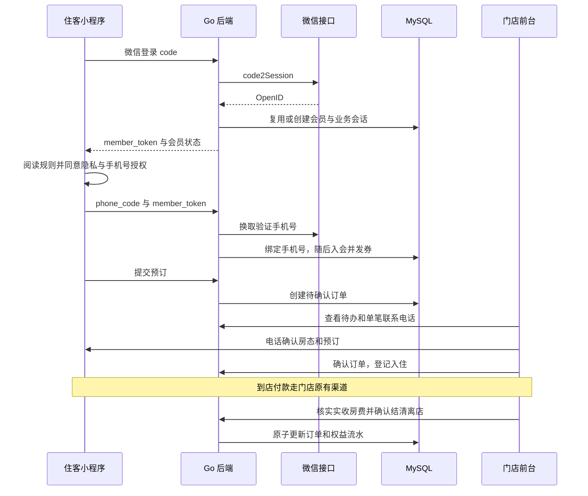

# 微信登录手机号授权与到店支付迭代需求及方案设计

日期：2026-11-17

状态：需求与设计交付。本文描述待实施的补充工作，不表示已经完成真实账号联调或生产发布。

## 1 目标与已确定范围

用户已确定：通过微信登录识别会员，通过微信授权绑定手机号；住客在线提交订房需求，实际付款在线下完成。本次不接短信和微信支付，不申请支付商户号，不接 PMS、公安入住系统或电子发票接口。

沿用原单店方案：前台人工确认房态和订单；会员、优惠券、返住金、单层推荐关系由本系统记录；入住登记、收款和发票仍走门店原流程。成功标准是普通住客能在正式小程序内真实入会和提交预订，前台能联系住客并依据真实线下收款完成订单。

**设计补充建议**：保留原方案的门店渠道码、个人推荐码和原生分享；首版暂缓自动订阅消息，采用后台待办加电话确认。这样仍需微信生成小程序码能力，但不增加独立供应商。延后消息提醒意味着原方案中的订单确认、券到期、返住金到账等自动触达不作为本次交付承诺。

人工办理和配置流程见[微信小程序到店支付版人工接入清单](../../wechat-onboarding-checklist.md)。

## 2 原方案和现有实现覆盖情况

以下结论针对当前 `hotel/` 工作区，包括未提交的已有改动；不能据此推断远程 `main` 或已部署服务器具备相同功能。

| 项目 | 已有依据或实现 | 本次仍需完成 |
| --- | --- | --- |
| 在线预订与到店付款 | [原产品方案第 6 节](../../../../docs/02-高碑店尚客优小程序产品方案.md)已明确；订单初始 `paid_status=pay_at_hotel` | 正式文案、确认联系流程、实收金额登记 |
| 微信登录 | [认证实现](../../../apps/api/internal/app/live_auth.go)已交换微信 code；[小程序入口](../../../apps/miniapp/app.js)已有 `wx.login` 分支 | 正式账号配置、真机联调、会话到期恢复 |
| 微信手机号授权 | 同一后端已调用手机号接口；[入会页](../../../apps/miniapp/pages/join/index.js)已有绑定入口 | 微信隐私衔接、已绑定用户复用、重试与老会员入会结果处理 |
| 接口契约 | [OpenAPI](../../contracts/openapi.yaml)已有 `/auth/wx-login`、`/auth/wx-bind-phone` | 核心身份接口复用；补充下文的联系、结算和码接口契约 |
| 真实存储与员工认证 | [MySQL 方案](../../architecture/mysql-phase2.md)已有迁移、会话、员工账号与权限设计及代码 | 隔离数据库、正式业务配置初始化、恢复验证 |
| 短信 | 真实环境路由未启用，契约保留计划项 | 本次维持禁用，不将固定验证码作为兜底 |
| 前台电话确认 | 原产品流程要求电话确认；[响应脱敏](../../../apps/api/internal/app/redaction.go)统一遮蔽员工看到的手机号 | 增加有权限、有审计的单笔订房联系电话查看 |
| 线下实收确认 | [订单服务](../../../apps/api/internal/app/service.go)在创建时把房价写入实际金额，离店时直接标记已付；[工作台](../../../apps/admin-web/src/app.js)自动回传已有金额 | 估算与实收分离，离店前明确核实线下结清，禁止估算金额触发奖励 |
| 渠道与推荐码 | [场景解析](../../../apps/miniapp/utils/scene.js)和原生分享已有；推荐页仍展示文本码 | 微信生成码、短场景参数解析、缓存、正式物料验收 |
| 隐私协议 | 入会页有普通同意开关 | 可阅读的协议、微信隐私同意状态同步、记录版本和时间 |
| 正式包 | 现有运行时配置可切换演示／HTTP／真实模式，多个页面仍有演示文案 | 发布环境固定为真实模式，锁定 HTTPS 地址，隐藏调试入口 |
| 自动消息和定时权益 | 原技术文档列出订阅消息；当前真实发送未实现，也未见 T+3 自动解冻任务 | 通知后置；原有权益时序如继续承诺，须另完成内部任务与验收，不能误认为接登录即可上线 |

现有设计已覆盖主体架构，不需要重新设计登录系统。增量工作集中在真实平台接入、正式版收口，以及线下预订流程中尚未闭合的操作。

## 3 外部依赖与实现路线

| 依赖 | 首版需要 | 说明 |
| --- | --- | --- |
| 认证过的非个人主体小程序、住宿类目、小程序备案 | 是 | 手机号能力和正式发布的前提 |
| 微信登录和手机号服务 | 是 | 使用同一 AppID；AppSecret 仅后端保存 |
| 微信生成小程序码服务 | 保留原扫码需求时需要 | 与登录复用账号及后台凭据，不需要另外采购二维码服务 |
| 大陆云服务器、ICP备案域名、HTTPS、MySQL及备份 | 当前部署路线需要 | 复用现有 Go、ECS、Nginx、MySQL 路线，不要求为了微信接入换成腾讯云 |
| 微信原生分享、拨号、地址展示 | 保留 | 无需新增供应商；导航若启用原生能力，按当时接口权限要求配置，不默认采集住客位置 |
| 短信、微信支付、订阅消息 | 否 | 短信与支付不在本次范围；订阅提醒建议后置 |
| PMS、电子发票、公安系统、现金奖励转账 | 否 | 沿用线下业务流程，返住金不提现 |
| 对象存储、Redis、CDN、消息队列 | 无新增硬性要求 | 单实例先用现有 MySQL 和持久化文件目录；不能把缓存目录放在部署时删除的版本目录中 |

路线比较：继续只用演示接口无法支撑真实运营；接入短信、支付、自动消息会增加申请和业务工作。采用已确定的微信身份能力与线下付款路线，并补齐原有扫码需求，复用现有代码量最多。后两项补充建议不代表用户已批准所有具体接口与数据结构，实施前以本设计的范围为依据落实契约。

## 4 用户与前台功能要求

### 4.1 登录和入会

- 系统调用微信登录并建立自己的登录会话，手机号授权与登录是独立步骤，不混用两种 code。
- 只在入会、需要联系的预订或主动换绑时要求手机号。浏览门店公开信息不强制手机号授权；微信服务异常时仍应显示基本联系电话和地址。
- 展示并允许阅读隐私政策和会员规则，用户同意后才能发起手机号授权；拒绝时保留浏览和电话联系入口，不切换固定短信验证码。
- 微信手机号绑定结果由后端确认，前端提交的手机号不能替代验证结果。绑定成功后入会失败，保留已绑定状态；重试只调用入会接口，不再次消耗手机号额度。
- 老会员再次进入不要求重领入会礼。重复入会返回原会员即可，前端不能把 `issued_coupons=[]` 一律判为失败；后端继续保证不重复发券。
- 同一手机号已经绑定另一会员时返回明确冲突，不自动合并订单或权益；由门店核实并通过后续受控账号处理流程解决。
- 正常登录复用会员记录；会话失效时重新登录。仅只读请求允许自动重试一次；手机号 code、预订、入会等写请求不得盲目重放。

### 4.2 在线预订和人工确认

- 住客提交日期、房型、到店时间、联系人和手机号。首版建议只允许已完成绑定的本人手机号作为订单联系电话；前端只读展示，服务端从会员记录取值并验证一致，暂不支持替他人订房。
- 后端验证日期先后、有效房型、联系人及会员状态，前端按钮防重复点击，服务端通过每次预订请求的幂等标识防止超时重试生成重复订单。
- 提交成功显示“待门店确认，到店付款”，注明前台确认后才保留房间。估算房费不是收款凭据，也不是实时库存承诺。
- 前台工作台展示待确认订单。建议每 30 秒刷新一次待办列表，只在页面可见且已登录时轮询；请求失败显示更新时间和重试入口。首次载入和新订单出现时在页面内明显提示，不承诺浏览器关闭后能通知。
- 前台在原酒店系统核对房态，受控查看该订单联系电话，电话确认后更新 `confirmed`；无法接待或住客取消时更新 `cancelled` 并填写原因。住客在“我的订单”查看状态，也可主动致电门店。
- 工作台列表与普通导出继续脱敏。前台、店长、老板仅通过单笔订单联系入口获取完整电话；记录操作者、订单、时间和用途，审计日志不保存完整号码。

### 4.3 到店付款与权益

- 流程为 `pending_confirm → confirmed → checked_in → checked_out`，付款仍由门店现有收款方式完成。小程序没有收款码支付确认接口，也不根据住客截图自动认定到账。
- 创建预订时不填充实际收款金额。估算金额按已配置房价与间夜计算并标为参考；房态和最终房费由门店确认。
- 离店操作弹出实收房费输入框和“已核对线下结清”确认项；金额初始留空，不自动带入估算金额。实收基数为扣除券、返住金等优惠后的实际房费，不含押金；金额以整数分存储。
- 只有明确确认结清且实收金额合法，才能在同一事务中完成离店、登记已付状态和按现有规则计算权益。允许实收为 0，必须说明原因且不发放按金额计算的奖励；不能再用估算金额兜底。
- 重复离店请求不得重复发放权益；相同幂等标识却提交不同金额应拒绝。离店提交前允许重新输入金额，成功结清后不得用同一状态更新接口直接覆盖历史金额。结清后的纠错／退款见下文上线前置项，本次不把已有手工调余额当作完整处理能力。
- 不改变原有返住金和推荐比例。T+3 解冻、到期失效与奖励撤回若仍在正式规则里，属于必须完成的内部业务能力，不需要支付供应商，但不能以本次登录接入代替其验收。

### 4.4 扫码与推荐

- 门店前台、房卡等使用长期正式小程序码；个人推荐保留原生分享卡片，并补充真正可扫描的推荐码。
- 分享来源用于营销归因，不用于证明支付人或实名身份。线下付款模式无法自动取得微信支付人标识，原方案“同支付人不计奖励”不能声称自动实现；首版依靠已有同会员／同手机号校验和前台核实。
- 会员核销码和“扫码打开小程序”的码是不同用途。会员码可在本地渲染或由后台输入会员编号查找，不需要采购扫码服务；不得把当前文本占位图当作已实现可扫描的会员码。

## 5 技术设计

### 5.1 核心链路

### 5.2 认证与隐私

复用 `LiveAuth`、`WeChatClient`、`LoginByOpenID` 和 `BindVerifiedPhone`。保留会员 7 天、员工 12 小时的现有业务会话期限；数据库仅保存会话令牌哈希。微信 `access_token` 由后端缓存，并提前更新。新增生成码也复用同一 token 管理，防止各模块各自刷新相互干扰。

补充微信 token 失效的识别与一次受控刷新；仅对明确表示 token 无效、尚未消费手机号 code 的响应重试。网络超时且消费结果未知时，不能无限重放 code，应提示重新操作。日志只记录内部请求 ID、微信错误码和接口名称，不记录 URL 查询中的 secret、token、code 或完整手机号。

入会页接入 `wx.getPrivacySetting`、协议展示和微信同意状态同步；可依据官方指南采用同意按钮与手机号组件组合。普通本地开关只表示业务规则确认，不能替代微信隐私机制。后端以受支持的隐私／会员规则版本和服务器时间记录同意，不存微信短期 code。[微信隐私协议指南](https://developers.weixin.qq.com/miniprogram/dev/framework/user-privacy/PrivacyAuthorize.html)

### 5.3 接口契约增量

以下是待实施的设计约定。本次不修改运行中的 API、OpenAPI 或调用方；开发时先更新 `docs/contracts/openapi.yaml`，并在同一变更中实现后端、小程序、工作台及验证。

| 接口 | 设计约定 |
| --- | --- |
| `POST /auth/wx-login` | 复用现有 `wx_login_code` 和返回结构；如带下述 `launch_token`，由后端解析来源，不能信任客户端伪造的推荐人 |
| `POST /auth/wx-bind-phone` | 复用 `phone_code`；增加可辨别的额度／权限／平台暂不可用错误语义，前端不展示供应商密钥或原始响应 |
| `POST /members/join` | 复用现有字段，新增受支持的规则版本标识；以服务器时间记录同意；重复入会允许返回空的新发券列表 |
| `POST /bookings` | 保留请求字段兼容，手机号必须与绑定结果一致；新增 `Idempotency-Key` 请求头，同一会员同一 key 同一请求返回原订单，不同请求内容返回冲突 |
| `GET /admin/bookings/{order_id}/contact` | 新增；仅老板、店长、前台，返回该订单联系信息，响应 `Cache-Control: no-store`；调用必须成功写入查看审计。此响应单独显式放行电话字段，不能关闭全局员工响应脱敏 |
| `PATCH /admin/bookings/{order_id}/status` | 离店时要求显式 `offline_payment_confirmed=true`、存在且大于等于零的 `actual_amount_cent` 和幂等标识；零元原因必填；其他状态不设置收款完成标记 |
| `GET /referrals/me` | 保留原字段兼容，新增正式 `share_path`、`share_code_image_url`；正式页面不再展示 `demo://` 文本 |
| `POST /referrals/bind` | 真实环境改用 `launch_token`，由服务端从有效映射解析推荐人；不得继续接受任意 `referrer_member_id` 绕过校验；原始 ID 方式只保留演示环境 |
| `GET /mini/public-info` | 新增公开只读门店名、电话、地址和必要展示信息；用于无需手机号的浏览与微信登录异常时联系门店，不包含会员资料 |

幂等记录存 MySQL：按调用者、操作、key 唯一，保存规范请求摘要、业务对象 ID 和最终结果；和业务创建／离店写入同一事务。网络中断后重复请求读取原结果；业务单据存在期间保留对应记录，单实例内存锁不替代数据库幂等约束。

### 5.4 小程序码与来源

后端调用微信 `getUnlimitedQRCode`。使用 `scene=t_<随机短令牌>`，令牌只由数字和字母组成，总长度不超过 32 个可见字符；在数据库 `launch_scenes` 中保存令牌与来源、推荐会员、页面、启用状态的对应关系。二维码里不放手机号或姓名。[微信生成码接口](https://developers.weixin.qq.com/miniprogram/dev/server/API/qrcode-link/qr-code/api_getunlimitedqrcode.html)

小程序识别 `t_` 场景并作为 `launch_token` 传给登录接口，后端校验并解析。既有长 query 分享路径迁移到同一短令牌机制；测试用旧参数只保留在演示环境。服务端在本次业务会话中保存验证过的来源令牌，入会时重新检查映射是否启用，不能被前端 `source`、`scene` 或 `referrer_member_id` 覆盖。已有会话打开新分享时，显式通过同样的令牌验证路径更新尚未入会用户的候选来源；不得依赖旧的 `loginReady` 缓存跳过验证。无效／停用令牌仍允许普通浏览，但不绑定推荐关系；已有推荐关系不被后续打开其他分享覆盖。

推荐令牌为可分享的归因标识，不是登录凭据。生成码缓存键包含 AppID、微信版本、页面及令牌；服务器使用持久化目录保存 PNG，由同一 HTTPS 域名提供。新增推荐会员时可按需生成，渠道码由技术脚本预生成；失败时仍提供原生分享路径，不展示假二维码。测试码指定 `trial`，正式码指定 `release`；正式发布后检查真实页面存在并重新扫码验收。

### 5.5 数据和运行环境

新增迁移至少覆盖：来源令牌映射、请求幂等记录、同意规则版本与时间、线下收款确认人和时间。订单 `actual_amount_cent` 在未核实时采用可空语义，不能把 0 与“未填”混为一谈；现有历史演示数据不自动视作真实收款。联系信息查看事件沿用审计表，不能把原始电话复制到审计详情。

正式业务初始化只写真实门店信息、启用的房型／价格、权益规则和券模板，不导入演示订单或住客。现有迁移主要建表，需补充可重复执行的正式配置初始化方式；MySQL 托管与否由部署负责人选择，已有满足隔离、备份和恢复要求的数据库可复用。

| 环境 | 小程序 | 后端和数据 |
| --- | --- | --- |
| `local-demo` | 演示入口仅开发可见 | 固定验证码与模拟数据仅限此环境 |
| `integration` | 真实 AppID 的开发／体验版本，明确测试标识 | 真实微信、独立测试库；可以消耗同一账号手机号额度 |
| `production` | 固定真实模式与生产 HTTPS 域名，忽略历史演示存储设置 | 真实微信、生产 MySQL，关闭 mock、短信模拟和 demo reset |

开发／体验和正式版使用同一 AppID 时，OpenID 身份体系相同，数据库和小程序本地 token 命名空间仍需按环境隔离；如有独立测试 AppID 则优先使用。不得让清理测试数据操作影响生产库。正式包需要核实 `project.config.json`、AppID、域名校验和所有页面的演示文案，不只改一处 API 地址。

## 6 实施分组与验收

| 分组 | 工作 | 完成标准 |
| --- | --- | --- |
| A 账号和部署 | 人工清单、HTTPS、独立库、真实配置和员工账号 | 关闭调试校验豁免后能访问正式域名；业务规则和券模板可用 |
| B 身份与隐私 | 复用认证代码，补隐私流程、会话恢复、重复入会和环境锁定 | 新客入会成功；老客不重复发券或重新付费取号；拒绝授权可继续浏览 |
| C 预订与线下结算 | 联系电话权限入口、待办刷新、本人电话校验、幂等、实收确认 | 前台可联系住客；未核实实收不可离店发奖；重复请求无重复订单或奖励 |
| D 渠道与分享 | 真小程序码、短场景映射、缓存、原生分享 | 前台／房卡／推荐码用真机验证；来源正确且不能覆盖既有推荐关系 |
| E 发布核查 | 真实账号端到端、审核物料、正式版配置及门店培训 | 普通住客和轮班前台完成一次完整业务流程 |

### 6.1 正式启用权益前的独立前置项

本迭代负责身份接入、预订和正常线下结清链路，**不新增已结清订单的退款／金额纠错模块**。门店现金退款仍在线下执行，但订单金额和权益处理必须有系统关联。正式启用真实住客的自动发奖前，必须另行完成并验收该内部模块，最低要求为：

- 老板／店长有明确的更正入口，记录原订单、原实收、新实收或退款额、原因、操作者和时间；原始结算记录不可被抹去。
- 能关联该订单产生的住客返住金和推荐人奖励，处理需要撤回的冻结／可用权益；已使用或不足扣回的权益要有明确的异常处理规则和待办，不能只把订单金额改小。
- 更正与权益流水有对应关系、可核对且支持重复请求幂等。现有 `AdjustWallet` 不具备上述完整关联能力，不能作为该前置项已完成的证据。

这一前置项及原有 T+3 等权益时序未通过验收时，本迭代可在隔离测试库验收登录、授权和预订，不应宣告整套会员产品可投入正式运营。若需先发布不发奖的简化产品，必须单独明确产品范围并同步规则与页面，不在本设计中默认取消原有权益承诺。

### 6.2 本迭代验收场景

最低验收场景：

1. 新微信用户登录、阅读规则、同意授权、入会，实际发券一次。
2. 拒绝手机号、手机号额度不足、code 过期、微信请求超时，均不产生伪绑定或演示兜底。
3. 老会员重新进入、会话到期、重复入会，以及绑定成功后入会请求中断，会员和券数量保持正确。
4. 使用他人的手机号或推荐参数伪造请求，被服务端拒绝或忽略；同手机号冲突不自动合并资产。
5. 提交两晚预订，参考金额与间夜一致；相同幂等请求只生成一张待确认订单。
6. 前台列表只见脱敏号码；主动查看单笔联系信息有权限和审计；财务及普通会员不能调用联系接口。
7. 无房取消、电话未接通、正常确认入住均有可解释状态；不出现“已支付”或自动保房的误导文案。
8. 未填实收／未勾结清不能离店；零元订单有原因且不发金额奖励；重复离店不会再次发奖。
9. 真机扫描渠道码与个人推荐码，跳转版本正确；分享新来源不会改变已建立的推荐关系。
10. 正式包不显示演示入口、示例手机号、固定验证码和任意 API 地址；开发工具域名校验开启，正常用户无需调试模式。
11. 数据库重启／服务重启后会员、会话、订单和码映射仍可恢复；备份可在隔离库恢复。

原有返住金抵扣、期限、冻结解冻、退款后的权益撤回以及前台核销，应沿既有产品方案单独回归；未满足的正式权益承诺须在上线前完成或明确收窄，不能因为身份能力接通就视为全产品可运营。

## 7 与旧文档的关系

[原外部依赖表](../../../../docs/04-技术方案设计/01-外部依赖表.md)覆盖采购和阶段概览，[原架构路线](../../../../docs/04-技术方案设计/02-技术选型与架构路线.md)覆盖自建后端与到店付款方向，[现有二期契约说明](../../contracts/phase-2-changes.md)覆盖已实现的微信认证和 MySQL。

本次补充明确无短信、无在线支付的发布范围，并识别真实扫码、隐私、前台联系和实收确认缺口。旧文档中的“二期接入订阅消息”“短信可选”等宽范围规划，不应作为本次必须采购的清单。原产品的其他业务规则未在本次重新制定。
